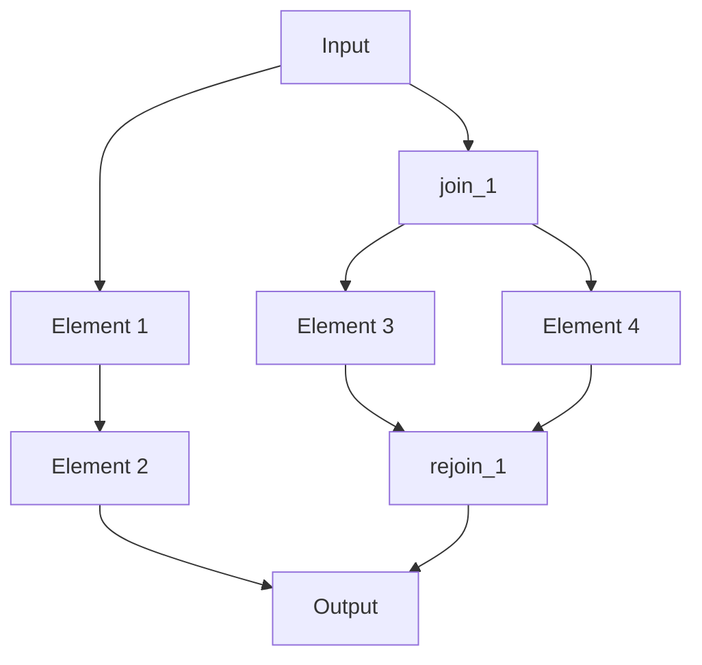

*Circuits* are an abstract input-output system.  They consist of an input, say $I$, with an element, such as a form of logical gate, that responds with an output, $O$.  Suppose that we would like to know the [[Introduction to Probability|probability]] that a given system functions as intended.  There are two different types of connections between elements for a circuit:
* **Series**, where one element is connected directly to another.  For these cases, we multiply the probability of each element working; that is, it is a joint probability.  
* **Parallel**, where there is “forking” in the line of the circuit.  In these cases, the probability of the system works is given by the [[Sizes of Sets|inclusion-exclusion principle]]; as both elements working are independent of one another.  
The rate of success is easier to calculate for a series connection, whereas it is easier to calculate the rate of failure of a parallel connection.  

